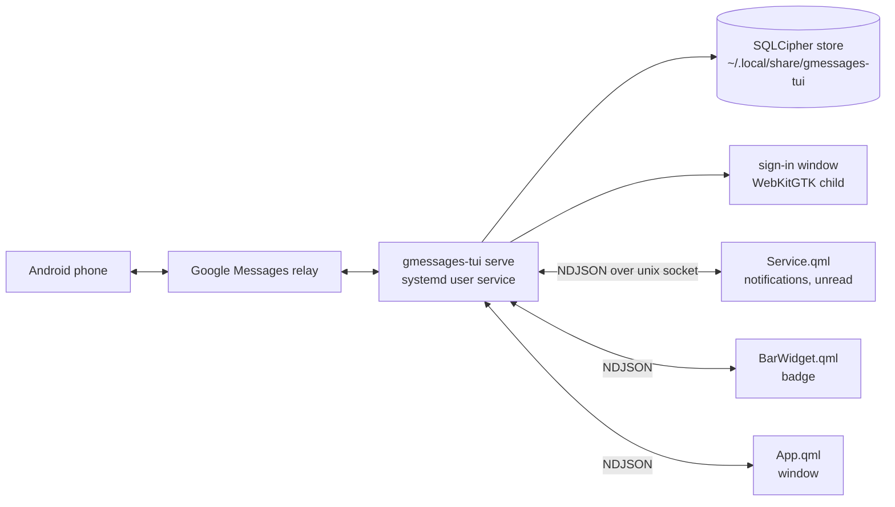

# Spec: Google Messages as an Omarchy shell plugin, packaged with Nix

## Decisions on the intent's open questions

These are defaults, chosen from what p620 already does. Change any of them at review.

| # | Question | Decision |
|---|----------|----------|
| 1 | Issue number | None. Issues stay disabled; the slug has no number. |
| 2 | Plugin id and name | `olafkfreund.gmessages`, shown as "Messages". |
| 3 | How p620 gets it | Home-manager's `programs.nixarchy.plugins."olafkfreund.gmessages".src` plus `local.omarchy.enableOnce`, in a new host module in `~/.config/nixos`, like `hosts/common/nixos/omarchy-omateams.nix`. The flake is an input there. |
| 4 | Secret Service on p620 | Whatever answers `org.freedesktop.secrets` on the session bus. The backend reports "locked" or "missing" in the window; we don't pick a provider. |
| 5 | Panel or window | Its own floating window (a Quickshell `FloatingWindow`), opened from the bar widget, a notification, or `omarchy-shell olafkfreund.gmessages toggle`. "One window, one job" fits better than a shell popover for a chat. |
| 6 | Stages | (a) packaging, backend, pairing, conversation list, history, send, badge, notifications; (b) media, reactions; (c) contacts and new chats, archive, restore, delete, unpair, remove all data. One plan per stage. This spec covers all three. |

## Design



### 1. Backend: `gmessages-tui serve`

A long-running daemon under systemd, not a child of the shell. This is the pattern of the
owner's `nixarchy-meetingai` plugin (`Client.qml`: newline-delimited JSON over a unix
socket, one client per QML entry point, events broadcast to all). It was chosen over
omamail's stdin/stdout child process because:
- three entry points need the same state;
- a plugin reload or shell restart must not drop the Google session;
- notifications keep working with the window closed.

Rust layout (the binary keeps its name and its state paths):

- `src/main.rs`: CLI only. It keeps `--version`, `--unpair` and `--uninstall`, adds
  `serve`, and keeps the hidden `--internal-google-signin`. The chat-tui `Backend` impl,
  `chat_tui::run` and `print_qr` are removed.
- `src/paths.rs` (new): replaces `chat_tui::Config`. Data is `dirs::data_dir()/gmessages-tui`
  (session, store, `phone.log`, the old TUI's read marks unused). Cache is
  `dirs::cache_dir()/gmessages-tui`. Runtime is `$XDG_RUNTIME_DIR/gmessages-tui` (mode 0700:
  socket, lock, decrypted media). These are the paths the TUI used, so `--uninstall` keeps
  working.
- `src/sync.rs` (new): the `Sync` logic moved out of `main.rs`, with its UI types replaced
  by the protocol types. It covers store writes, missed and old message tracking, and
  history fetches.
- `src/serve.rs` (new): socket server, clients, request dispatch, event broadcast,
  lifecycle.
- `src/proto.rs` (new): the wire types, versioned. They are the only types that are
  serialized to clients.
- `src/store.rs`: its one `chat_tui::data::Attachment` use becomes a local type.
- `src/phone.rs`, `pair.rs`, `web.rs`, `signin*`: unchanged except where `Sync` moving
  requires it.
- `Cargo.toml`: drop `chat-tui-core`, `crossterm` and `rpassword` (no terminal prompt any
  more). Add `qrcode` and `dirs` (both already in the lock tree) as direct dependencies.
  `emoji-expander` goes if nothing else pulls it.

Lifecycle:
- **Single instance:** `flock` on `runtime/lock`. A second `serve` exits 1 with
  "already running (pid N)".
- **Startup:** it binds `runtime/daemon.sock` (0600) and accepts only peers with its own
  uid (`SO_PEERCRED`). Then it opens the store, then starts the phone.
- **Shutdown:** SIGTERM, SIGINT and a systemd stop call `phone::Control::stop` (which
  saves the session), kill the sign-in child, remove the socket, and exit within 5 s.
- **Store key** (`src/key.rs`): `GMESSAGES_TUI_PASSPHRASE` if set; empty is refused. Else
  the keyring. When the keyring is locked or missing, the backend stays up in state
  `locked` and retries on `key.retry` and every 30 s. A keyring that refuses to store a new
  key is reported, never fatal (fixes `key.rs:29`). The rpassword prompt is gone. A store
  that exists but won't open with the key is never recreated.
- **Sending:** a send whose delivery is uncertain (timeout) is reported as
  `send_uncertain` and never retried automatically.

### 2. Protocol v1 (`src/proto.rs`)

One JSON object per line. The maximum line is 1 MiB; a longer line closes that client.

- **Request** `{"id": 7, "method": "send", "params": {...}}`, then **reply**
  `{"id": 7, "ok": true, "data": {...}}` or
  `{"id": 7, "ok": false, "error": {"code": "not_paired", "message": "..."}}`.
- **Event** `{"event": "message", "data": {...}}`. The first line on every connection is
  `hello`: `{"protocol": 1, "version": "v1.3.6+…", "state": "...", "unread": N}`.
- A malformed line or an unknown method gets an error reply (`bad_request`,
  `unknown_method`). The client stays connected.
- **Error codes** are stable strings that the plugin translates: `not_paired`,
  `locked`, `keyring_missing`, `store_unreadable`, `phone_offline`, `send_uncertain`,
  `not_found`, `bad_request`, `unknown_method`, `busy`, `internal`.

**States:** `starting`, `locked`, `login` (not paired), `pairing`, `connecting`,
`ready`, `expired` (sign in again), `fatal`.

| Stage | Methods | Events |
|-------|---------|--------|
| a | `state`, `key.retry`, `pair.start {method: google\|qr\|manual}`, `pair.cancel`, `conversations {folder}`, `history {conversation, before?}`, `send {conversation, text, reply_to?}`, `read {conversation}`, `ui.focus {conversation\|null}` | `hello`, `state`, `pairing {emoji?, qr_svg?, manual_url?, error?}`, `conversation`, `message {conversation, message, notify}`, `typing`, `status` |
| b | `media.open {message, index}` → `{path}`, `media.save {message, index}` → `{path}`, `react {message, emoji, op}` | `downloaded` |
| c | `contacts`, `chat.start {numbers}`, `archive`, `restore`, `delete.chat`, `delete.message`, `unpair`, `uninstall` | `gone`, `unpaired` |

Secrets never reach QML:
- The DTOs have no cookie, key, token or media-key fields. A unit test serializes every
  DTO from a fixture full of secrets and checks that none of them appear.
- Google sign-in runs in the backend's own window. The manual fallback is the existing
  localhost page (`src/web.rs`): the window shows its URL, and the cookies go from the
  browser straight to the backend.
- Media is decrypted into `runtime/media/<sha256(message,index)>.<ext>` (0600). The window
  loads it with `file://`. `media.save` copies it atomically into the XDG Downloads
  directory and never overwrites a file there. The runtime dir is tmpfs and is cleared
  on stop.

`message.notify` is true only for a live incoming message from someone else that isn't
`old`, isn't missed-history replay and isn't from me, and whose conversation isn't the one
`ui.focus` reports as open and focused. The backend decides this once, so the three QML
clients agree. `unread` is the number of inbox conversations with the phone's `unread`
flag (`phone::Conversation.unread`).

### 3. Plugin `olafkfreund.gmessages` (`plugin/`)

The same shape as `nixarchy.meetingai`:
- `manifest.json`: kinds `service`, `bar-widget`, `panel`. Category "Communication",
  default section right.
- `Client.qml`: Quickshell.Io `Socket` to `$XDG_RUNTIME_DIR/gmessages-tui/daemon.sock`.
  Reconnect with backoff, `send(method, params, cb)` with id correlation and a 15 s reply
  timeout, `protocol !== 1` turned into a visible mismatch state.
- `Service.qml`: one Client. On `message.notify` it runs
  `notify-send -a Messages -A open=Open <sender> <text>`; Open shows the window on that
  conversation. It also exposes the IPC target `olafkfreund.gmessages` with `toggle`
  and `open <conversation>`.
- `BarWidget.qml`: an icon with the unread badge. Its states (not paired, locked,
  offline) get distinct icons. Click toggles the window.
- `App.qml`: a `FloatingWindow` with the app id `olafkfreund.gmessages`, made of
  `ConversationList.qml`, `Thread.qml`, `Composer.qml`, `PairView.qml`, `HelpOverlay.qml`
  and `Confirm.qml`. A narrow window shows one column, a wide one shows two.
- `Theme.qml`: the meetingai approach (`qs.Commons` `Style`: fonts, spacing,
  `Style.cornerRadius`, colors), so theme, accent and rounding follow live.
- Strings: every visible string goes through the shell's `I18n`, like first-party
  plugins. English is the only language shipped. Backend error codes map to translated
  strings in `Errors.js`.
- Keys: `j`/`k` or arrows move, `Enter` opens, `i` composes, `Ctrl+Enter` sends, `Esc`
  goes back or closes, `/` filters, `?` shows the shortcuts, `q` closes the window.
  Destructive actions (stage c) go through `Confirm.qml`.

### 4. Nix (`flake.nix`, `nix/`)

- `nix/package.nix`: `rustPlatform.buildRustPackage` with `cargoLock.lockFile` (plus
  `outputHashes` for any remaining git dependency).
  - `nativeBuildInputs`: `pkg-config`, `wrapGAppsHook3`, `perl`.
  - `buildInputs`: `openssl`, `dbus`, `gtk3`, `webkitgtk_4_1`, `libsoup_3`,
    `glib-networking`.
  - Tests run with `doCheck` (`cargo test --workspace`). Any test that needs the network
    or a display is skipped by name, with the reason in a comment.
- `nix/plugin.nix`: copies `plugin/` to `$out`, and its check runs `qmllint` with the
  Quickshell import paths.
- `nix/hm-module.nix` (`homeManagerModules.default`), option `services.gmessages`:
  - `enable`, `package`;
  - a `systemd.user.services.gmessages-tui` running `serve`, with
    `PartOf`/`WantedBy=graphical-session.target` (so the sign-in window gets
    `WAYLAND_DISPLAY`), `Restart=on-failure`, and no hardening that would break WebKit's
    bubblewrap sandbox;
  - `programs.nixarchy.plugins."olafkfreund.gmessages".src` when that option exists,
    else `xdg.configFile."omarchy/plugins/olafkfreund.gmessages"`.
- `flake.nix` outputs:
  - `packages.x86_64-linux.{default, gmessages-tui, plugin}`, `overlays.default`;
  - `homeManagerModules.default`, `devShells.default`;
  - `checks`: the package with its tests, the plugin with qmllint, the protocol
    integration test.
  - nixpkgs: `nixos-unstable`, as p620 uses.
- The protocol integration test is `tests/serve.rs`, run inside the package's
  `cargo test`. It starts `serve` with temp XDG dirs and `GMESSAGES_TUI_PASSPHRASE`, then
  checks:
  - `hello` arrives, with state `login`;
  - a malformed line gets an error reply and the client stays connected;
  - a second `serve` is refused;
  - SIGTERM removes the socket.

  `Sync` gets unit tests that drive `phone::Event`s through `Commands::detached()`
  (`src/phone.rs:391`), checking the `notify` rules and that history replay is quiet.

### 5. Bug fixes (intent)

- `src/key.rs`: refuse an empty passphrase. A failing `set_password` gives `locked` or
  `keyring_missing`, not an abort. Unit tests cover both.
- `gmessages-proto/src/codec.rs:61`: truncate on a char boundary. A unit test with 21
  "é" characters covers it.

## Alternatives rejected

- **stdin/stdout child of `Service.qml` (omamail):** the bar widget and the window
  would have to go through the service's instance, and a plugin reload would kill the
  Google session.
- **D-Bus API:** more code than NDJSON. Quickshell has a native `Socket`, and the owner's
  meetingai already proves this transport.
- **Serializing `phone::Event`/`Command` directly:** leaks cookies and media keys.
- **Keeping the TUI in the build:** the owner chose plugin only, and dropping it removes
  a git dependency and the terminal prompt.
- **Standalone Qt C++ app (omarchy-app pattern):** more code, and it doesn't live in the
  bar.

## Risks

- **Google refuses the embedded window:** the window falls back to the manual localhost
  page (it already exists). Checked by hand on p620.
- **Sign-in window from a systemd user service:** it depends on uwsm having exported
  `WAYLAND_DISPLAY`, `DBUS_SESSION_BUS_ADDRESS` and `XDG_RUNTIME_DIR` to the user manager.
  Checked by hand on p620 in stage a; if it fails, the unit gets `PassEnvironment`.
- **Keyring locked at login, before the service starts:** handled by the `locked`
  state and the retry.
- **Quickshell `Socket` and long lines:** history replies can be large. The backend pages
  history (50 messages per reply), and the client checks that a 1 MiB line parses.
- **Fork divergence:** `main.rs` is largely replaced, so upstream merges into `src/` will
  conflict. The bug reports go upstream; this fork carries its own path from here.
- **Plugin API drift:** first-party Commons (`Style`, `I18n`) can change with nixarchy
  updates, as for every third-party plugin. qmllint in `checks` catches renamed
  imports at build time.
- **Data:** there is no existing state on p620 (`~/.local/share/gmessages-tui` is absent),
  so no migration risk there. The paths stay the TUI's for anyone else.

## Verification

Sandbox (every stage):

```bash
nix flake check
nix build .#gmessages-tui .#plugin
nix run . -- --version
```

On p620, by hand with the owner, after each stage's home-manager switch:

1. The user unit `gmessages-tui` is active.
2. `omarchy-shell shell listPlugins` shows `olafkfreund.gmessages` enabled.
3. Pairing works: the sign-in window opens, the emoji shows in the window, and the phone
   accepts it. The manual URL works when the sign-in window is refused.
4. The conversation list and history load. A message is sent and shows up on the phone.
   A reply from the phone notifies once, and not while that thread is focused.
5. After the unit is started again, and after the machine boots again, everything
   reopens without pairing.
6. Locking the keyring before the unit starts shows `locked` in the window, and
   unlocking with retry recovers.
7. A theme switch and a rounding change apply live to the window and the badge.
8. Stage b: an image opens and saves. A reaction appears on the phone.
9. Stage c: a new chat starts. Archive and restore work, and delete asks first. Unpair
   keeps the store; uninstall removes everything.
