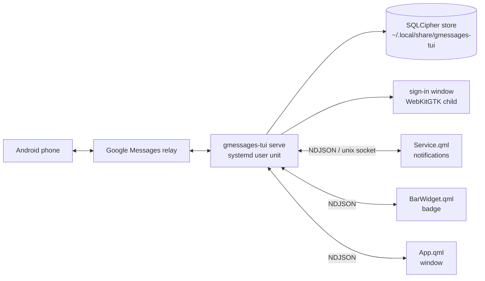

# Spec: Google Messages as an Omarchy shell plugin, packaged with Nix

## Decisions on the intent's open questions

These are defaults, chosen from what p620 already does. Change any of them at review.

| # | Question | Decision |
|---|----------|----------|
| 1 | Issue number | None. Issues stay disabled; the slug has no number. |
| 2 | Plugin id and name | `olafkfreund.gmessages`, shown as "Messages". The license is AGPL-3.0-only, the same as the repository. |
| 3 | How p620 gets it | The flake is an input of `~/.config/nixos`. A new host module, like `hosts/common/nixos/omarchy-omateams.nix`, imports `homeManagerModules.default` (package and user unit) and sets `programs.nixarchy.plugins."olafkfreund.gmessages".src` and `local.omarchy.enableOnce`. The flake's own module doesn't touch nixarchy options, so it evaluates anywhere. |
| 4 | Secret Service on p620 | Whatever answers `org.freedesktop.secrets` on the session bus. The window reports "locked" or "missing"; we don't pick a provider. |
| 5 | Panel or window | Its own floating window: manifest kind `panel`, entry `App.qml`, a Quickshell `FloatingWindow`, the same as omamail's panel opened as a window. It opens from the bar widget, a notification, or `omarchy-shell olafkfreund.gmessages toggle`. |
| 6 | Stages | (a) packaging, backend, pairing, conversation list, history, send, badge, notifications; (b) media, reactions, contact pictures; (c) contacts and new chats, archive, restore, delete, unpair, remove all data. One plan per stage. This spec covers all three. |

**One deliberate change to the intent, for approval.** The intent said the backend stops
on stdin EOF so that "a plugin reload or shell exit leaves nothing behind". This design
runs the backend as a systemd user unit instead. It survives plugin reloads and shell
restarts, so the Google session and notifications don't drop. "Nothing behind" becomes
"nothing unmanaged": the unit is the one owner, systemd stops it at logout, and stopping
it cleans up. The intent's "tests over real pipes" become tests over the real socket.

## Design



This is the transport of the owner's `nixarchy-meetingai` plugin (`Client.qml`:
newline-delimited JSON over a unix socket, one client per QML entry point, events
broadcast to all).

### 1. Backend: `gmessages-tui serve`

**CLI** (`src/main.rs`): `serve`, `--version` and the hidden `--internal-google-signin`,
nothing else. `--unpair` and `--uninstall` leave the CLI. They become daemon methods
(stage c), so nothing races the running owner of the store.

**Removed with the TUI:**
- the chat-tui `Backend` impl and `chat_tui::run` / `Config` / `qr::print_qr`;
- crossterm and rpassword;
- the terminal reader of manual pairing: `pair.rs` `read_terminal`, raw mode, and the
  cURL paste in the terminal.

The manual path is now only the localhost page in `src/web.rs`, which already takes the
cookies from a browser. `pair::say` (stdout) gives way to `pairing` events.

**Module changes:**
- `src/paths.rs` (new): data is `dirs::data_dir()/gmessages-tui`, the path the README
  documents for the TUI. Cache is `dirs::cache_dir()/gmessages-tui`. Runtime is
  `$XDG_RUNTIME_DIR/gmessages-tui`, created by systemd (`RuntimeDirectory=`, removed when
  the unit stops) and cleared by `serve` at startup too.
- `src/sync.rs` (new): `Sync` moved from `main.rs`, emitting protocol events instead of
  chat-tui events. It keeps the `known`/`deleted`/`old` checks of `Sync::live`
  (`main.rs:460-496`).
- `src/serve.rs` (new): socket, clients, dispatch, broadcast, lifecycle.
- `src/proto.rs` (new): the wire types, and the only serialized types.
- `src/store.rs`:
  - a local `Attachment` replaces chat-tui's, with the same fields and `PartialEq`;
  - a new `unread INTEGER NOT NULL DEFAULT 0` column on `conversations`, written with
    each conversation;
  - migration v5, run inside a transaction with its `user_version` update. Older
    migrations are untouched.
- `src/phone.rs`:
  - `pair` keeps its `CancelToken` in `State`, so a new `Command::CancelPairing` can
    stop pairing.
  - `send` returns a typed outcome: `Sent(message)` (echoed), `Accepted(message)`
    (accepted, no echo yet: temporary id, replaced at the next fetch), `Rejected(reason)`,
    or `Uncertain(reason)` (transport error once the request may have left).
  - `Command::Read` clears the local `unread` flag.
- `src/web.rs`: `Page` aborts its server task on drop, so a cancelled pairing revokes its
  URL. The URL is never logged.
- `src/key.rs`: blocking keyring calls run in `spawn_blocking`.
- `phone.log`: `info` by default, cut to its last 1 MiB at startup. It never logs message
  text, cookies, tokens or the pairing URL. A plan step greps the existing `tracing`
  calls for these.
- `Cargo.toml`: drop `chat-tui-core`, `crossterm` and `rpassword`. Add `qrcode` and
  `dirs` (both already in the lock tree) as direct dependencies. `emoji-expander` goes if
  nothing else pulls it.

**Lifecycle:**
- **Single owner:** `flock` (close-on-exec) on `<data>/lock`, which guards the store
  itself. A second `serve` exits 1 with "already running (pid N)". With the lock held, a
  stale `daemon.sock` is removed, then the socket is bound (0600). Only peers with the
  daemon's uid are accepted (`SO_PEERCRED`).
- **Startup order:** lock, socket, store key, store, phone. Each state is visible to
  clients as it happens.
- **Shutdown:** SIGTERM or SIGINT calls `phone::Control::stop` (session saved), kills the
  sign-in child, clears `runtime/media`, removes the socket, and exits within 5 s.
- **Destructive methods** (stage c `unpair`, `uninstall`): stop the phone without saving
  the session, finish in-flight work, then delete. Unpair keeps the store; uninstall
  deletes the store, its keyring entry, the cache and the data dir.
- **Store key:** `GMESSAGES_TUI_PASSPHRASE` if set; empty is refused. Else the keyring.
  Locked, missing or refusing to store gives the `locked` or `keyring_missing` state and
  a retry on `key.retry` and every 30 s. It is never fatal (fixes `key.rs:29`). A store
  that exists but won't open gives `store_unreadable` and is never recreated.

### 2. Protocol v1 (`src/proto.rs`)

One JSON object per line, 1 MiB at most. A longer line, or a client whose outgoing queue
passes 1000 lines, is disconnected. It reconnects and starts over from `hello`.

- **Handshake:**
  - The daemon sends `{"event":"hello","data":{"protocol":1,"version":"v1.3.6+…",
    "state":"…","detail":null,"unread":N}}`.
  - The client sends `{"id":0,"method":"hello","params":{"protocol":1,"role":"app|bar|service"}}`.
  - On a protocol mismatch, either side reports `protocol_mismatch`. The daemon then
    refuses every other method from that client.
- **Requests and replies:**
  - Request: `{"id":N,"method":"…","params":{…}}`.
  - Reply: `{"id":N,"ok":true,"data":{…}}` or
    `{"id":N,"ok":false,"error":{"code":"…","message":"…"}}`.
  - Ids are per connection. The daemon maps (connection, id) to its own global ids
    toward the phone layer.
  - A malformed line gets `{"id":null,"ok":false,"error":{"code":"bad_request"}}`.
  - When a client disconnects, its pending replies are dropped, but their effects (a
    sent message, say) still reach the store and are broadcast.
- **Deadlines:** the daemon replies within each method's deadline: `send` 120 s,
  `media.*` 60 s, `unpair` 30 s, stage c actions 30 s, everything else 15 s. A client
  waits that deadline plus 5 s.
- **States:** `starting`, `locked`, `keyring_missing`, `store_unreadable`, `login`,
  `pairing`, `connecting`, `ready`, `expired`, `fatal`. The `state` event carries
  `{state, detail}`. A phone-side logout (`phone.rs:835`) becomes `login` with detail
  `unpaired_remotely`.
- **Error codes:** `not_paired`, `locked`, `phone_offline`, `send_rejected`,
  `send_uncertain`, `not_found`, `bad_request`, `unknown_method`, `protocol_mismatch`,
  `busy`, `timeout`, `internal`.

| Stage | Methods → reply data | Events |
|-------|----------------------|--------|
| a | `hello`; `state` → `{state, detail, unread}`; `key.retry`; `pair.start {method: google\|qr\|manual}`; `pair.cancel`; `conversations {folder, offset, limit≤200}` → `{items, total}`; `history {conversation}` → `{messages, truncated}`; `send {conversation, text, reply_to?}` → `{status: sent\|accepted, message}`; `read {conversation}`; `focus {conversation\|null}` | `state`, `pairing {emoji?, qr_svg?, manual_url?, message?}`, `conversation`, `history {conversation, messages}`, `message {conversation, message, notify}`, `missed {count}`, `unread {count}`, `typing` |
| b | `media.open {message, index}` → `{path}`; `media.save {message, index}` → `{path}`; `react {conversation, message, emoji, op}`; conversation items gain `color` and `avatar` (section 6) | `avatar {conversation, path}` |
| c | `contacts {offset, limit}`; `chat.start {numbers}`; `archive`, `restore`, `delete.chat {conversation}`; `delete.message {conversation, message}`; `unpair`; `uninstall` | `gone {conversation}` |

**History:**
- `history` replies at once from the store, with the last 200 messages and `truncated`
  if there are more.
- The phone fetch of the newest messages (`phone.rs:1232`, `HISTORY_COUNT`) lands later
  as a `history` event.
- Older messages beyond the store stay out of scope, as in the TUI: there is no paging
  cursor in the phone layer to build on.

**Secrets never reach QML:**
- The DTOs have no cookie, key, token or media-key fields. A unit test fills every
  source type with marker secrets, serializes each DTO, and checks that no marker
  appears.
- Google sign-in runs in the backend's window. The manual URL is shown in the window,
  and the cookies go from the browser straight to the backend.
- Media is decrypted into `runtime/media/<sha256(message,index)>.<ext>` (0600) and loaded
  with `file://`. `media.save` copies it atomically into the XDG Downloads directory and
  never overwrites a file there.

**Notifications and unread:**
- `message.notify` is true only when all of these hold:
  - the message is live (`old: false`) and new to the store (`known: false`);
  - it isn't deleted and isn't from me;
  - no client's current `focus` names its conversation.
- Focus belongs to the connection that set it and is cleared when that connection drops.
- Missed messages after a reconnect give one `missed {count}` event, not one per message.
- `unread` counts inbox conversations whose stored `unread` flag is set. It is correct
  offline from the store, and it is re-sent whenever it changes.

### 3. Plugin `olafkfreund.gmessages` (`plugin/`)

The same file shape as `nixarchy.meetingai`:
- `manifest.json`: kinds `service`, `bar-widget`, `panel`; license AGPL-3.0-only;
  category "Communication".
- `Client.qml`: Quickshell.Io `Socket` to `$XDG_RUNTIME_DIR/gmessages-tui/daemon.sock`.
  It does the handshake, keeps a per-method deadline for each pending id, reconnects with
  backoff, and shows a protocol mismatch as a visible state.
- `Service.qml`: one Client, role `service`.
  - On `message.notify` or `missed`, it runs `@notifySend@ -a Messages -A open=Open --
    <sender> <text>` as a `Process`, at most 3 at a time. `@notifySend@` is substituted
    with the libnotify path at build time.
  - The Open action shows the window on that conversation.
  - It owns the IPC target `olafkfreund.gmessages` (`toggle`, `open <conversation>`).
- `BarWidget.qml`: an icon with the unread badge. The not paired, locked and offline
  states get distinct icons. Click toggles the window.
- `App.qml`: a `FloatingWindow` with the app id `olafkfreund.gmessages`. It contains
  `ConversationList`, `Thread`, `Composer`, `PairView`, `HelpOverlay` and `Confirm`: one
  column when narrow, two when wide. It sends `focus` while a thread is open and the
  window is active.
- `Theme.qml`: the meetingai approach (`qs.Commons` `Style`), so fonts, spacing,
  `Style.cornerRadius` and colors follow live.
- Strings go through the shell's `I18n`, with English only. Backend codes map to strings
  in `Errors.js`.
- Keys: `j`/`k` or arrows, `Enter` opens, `i` composes, `Ctrl+Enter` sends, `Esc` goes
  back or closes, `/` filters, `?` shows the shortcuts, `q` closes. Stage c's destructive
  actions go through `Confirm`.

### 4. Nix

- **`nix/package.nix`:** `rustPlatform.buildRustPackage` with `cargoLock.lockFile`.
  - `nativeBuildInputs`: `pkg-config`, `wrapGAppsHook3`, `perl`.
  - `buildInputs`: `openssl`, `dbus`, `gtk3`, `webkitgtk_4_1`, `libsoup_3`,
    `glib-networking`.
  - `doCheck` runs `cargo test --workspace`. Each skipped test is named, with its reason.
- **`nix/plugin.nix`:** copies `plugin/`, substitutes `@notifySend@`, and checks that
  every QML file parses. It uses `qmllint` with unresolved imports allowed, because
  `qs.Commons` exists only inside the running shell. Loading for real is checked on
  p620.
- **`nix/hm-module.nix`** (`homeManagerModules.default`), `services.gmessages`:
  - `enable`, `package`;
  - `home.packages = [ package ]`;
  - a `systemd.user.services.gmessages-tui` running `serve`, with
    `PartOf`/`After`/`WantedBy=graphical-session.target`, `RuntimeDirectory=gmessages-tui`,
    `Restart=on-failure`, and no sandboxing options that would stop WebKit's bubblewrap.
- **`flake.nix`:** input `nixpkgs` (nixos-unstable). Outputs:
  - `packages.x86_64-linux.{default, gmessages-tui, plugin}`;
  - `overlays.default`, `homeManagerModules.default`, `devShells.default`;
  - `checks`: package with tests, plugin parse.
- **Tests** (inside the package's `cargo test`):
  - `tests/serve.rs` starts the real binary with temp XDG dirs and
    `GMESSAGES_TUI_PASSPHRASE`, then checks:
    - the handshake, and state `login`;
    - a malformed line gets an error and the client stays connected;
    - a protocol mismatch is refused;
    - a second instance is refused;
    - a stale socket left by `kill -9` is recovered on the next start;
    - SIGTERM removes the socket and the media.
  - Unit tests in `sync.rs` feed `phone::Event` values straight into `Sync`, using the
    `#[cfg(test)]` `Commands::detached()` to capture what it asks the phone. They check
    the notify rules, that history replay and updates of known messages stay quiet, the
    `missed` summary, and the `unread` count.
  - `proto.rs` has the secrets test. `key.rs` and `codec.rs` have the bug-fix tests.

### 5. Bug fixes (intent)

- `src/key.rs`: as in section 1 (empty passphrase refused; no abort on a keyring
  failure).
- `gmessages-proto/src/codec.rs:61`: truncate on a char boundary, with a test using 21
  "é" characters.

### 6. Contact pictures (stage b)

Added on 2026-11-12, after the owner saw the stage a list on p620 without pictures.

**What the user sees:**
- Each row of the list has a round picture at the start, and the thread header has a
  larger one.
- A conversation with no picture shows a circle in the phone's colour for it, with the
  initials of its name.
- A group shows its initials circle. Group pictures (`group_avatar_url`) are out of scope.

**Backend:**
- **Which picture:** a 1:1 conversation uses its single participant that isn't us
  (`is_me == false`, `visible`). The phone layer already has
  `participant_thumbnails(ids)` (action 37, `gmessages-proto/src/client.rs:584`). The
  daemon doesn't call it today.
- **When it's fetched:**
  - after each `conversations` reply and each `conversation` event, for participants
    not yet tried in this run;
  - in batches of up to 50 ids, at most one batch in flight;
  - an id is tried once per daemon run. A participant with no picture, or a failed
    call, isn't asked again until the unit starts again.
  - Fetching only happens in `ready`. A failure is logged with a count, never the ids,
    and never changes the state.
- **Where it's kept:** `runtime/avatars/<sha256(participant id)>`, mode 0600, the same as
  decrypted media.
  - It's written atomically: written beside the target, then renamed.
  - The runtime dir is tmpfs, mode 0700, and cleared on stop. Pictures are never written
    to the persistent cache, because the store they come from is encrypted.
  - Each start fetches them again, which costs one batch per 50 contacts.
  - A response that isn't JPEG, PNG or WebP (checked by its magic bytes), or that is
    over 512 KiB, is dropped.
- **Protocol:**
  - Conversation items gain `color` (the phone's hex colour, or `""`) and `avatar` (an
    absolute path, or `null`).
  - When a picture lands, the daemon broadcasts `avatar {conversation, path}` once for
    every conversation that uses that participant.
  - `avatar` is additive, so the protocol stays at 1, and stage a clients ignore it.
  - No secret fields are added, and the no-secrets test covers the new fields.

**Plugin:**
- **`Avatar.qml`:** an `Image` from `file://` + path, clipped to a circle with
  Quickshell's `ClippingRectangle`. With no path, or when the image fails to load, it
  shows the initials circle instead.
- **Size and colour:** 32 px in the list and 40 px in the thread header, at the theme
  scale. Initials use the theme font on `color`, or on the theme's surface colour when
  `color` is empty.
- **Updates:** `ConversationList` and `Thread` set the path from the `avatar` event. The
  image reloads when the path changes.

## Alternatives rejected

- **Contact pictures in `~/.cache` or in the store:** a persistent plaintext cache would
  leak what the encrypted store protects; a store table means a migration for data the
  phone serves again in one call per 50 contacts.
- **Fetching pictures in QML:** the phone layer and its session live in the daemon only.
- **stdin/stdout child of `Service.qml` (omamail):** the bar and the window would go
  through one instance, and a plugin reload would drop the Google session.
- **D-Bus API:** more code than NDJSON. Quickshell has `Socket`, and meetingai proves
  the transport.
- **Serializing `phone::Event`/`Command`:** leaks cookies and media keys.
- **Notifications from the backend over D-Bus:** a new dependency, and the shell's own
  notify path is already proven by meetingai.
- **Keeping CLI `--unpair`/`--uninstall`:** they would race the daemon for the store.
- **Nixarchy options inside the flake's module, or the nixarchy flake as an input for
  qmllint:** this couples the flake to one desktop and adds a heavy input. The host
  module sets the plugin option instead, and the real load is checked on p620.
- **History paging:** there's no cursor in the phone layer, and the TUI doesn't page
  either.

## Risks

- Contact pictures: action 37's request shape is from the reverse-engineered client and
  unverified here; if the phone rejects it, the list keeps the initials circles and the
  daemon logs the failure once per batch.

- **Google refuses the embedded window:** the manual localhost page is the fallback.
  Checked by hand.
- **Sign-in window from a systemd user unit:** it needs `WAYLAND_DISPLAY` and the session
  bus in the user manager. Checked on p620 in stage a with `systemctl --user
  show-environment` before relying on it.
- **Keyring locked at login:** the `locked` state and the retry.
- **The real Quickshell `Socket` line limit:** unknown. Stage a tests a 1 MiB line
  through the real Client on p620.
- **Fork divergence:** `main.rs` and `pair.rs` change heavily. Upstream bug reports are a
  separate follow-up, not part of these plans.
- **Plugin API drift** (`qs.Commons`): only caught when the plugin loads on p620. Each
  stage's check includes the shell journal.
- **Data:** p620 has no existing state, so there is no migration risk there.

## Verification

Sandbox (every stage):

```bash
nix flake check
nix build .#gmessages-tui .#plugin
nix run . -- --version
```

On p620, after a `nixos-rebuild switch` of `~/.config/nixos`. The owner OKs each
switch, and the checks are done together:

1. The user unit is active. Its environment has `WAYLAND_DISPLAY`.
2. `omarchy-shell shell listPlugins` shows `olafkfreund.gmessages` enabled and active,
   and the shell journal shows no QML errors for it.
3. Pairing: the sign-in window opens, the emoji shows in the window, and the phone
   accepts it. The manual URL works when the sign-in window is refused.
4. The conversation list and history load. A message is sent and shows up on the phone.
   A phone reply notifies once, and not while its thread is focused. The badge counts
   unread conversations and drops after reading.
5. After the unit starts again, and after the machine boots again, everything reopens
   without pairing.
6. A locked keyring shows `locked`, and unlocking with retry recovers.
7. A theme switch and a rounding change apply live.
8. Stage b: an image opens and saves. A reaction reaches the phone. Contacts with a
   picture on the phone show it in the list and the thread header; the others show
   initials. After the unit starts again, the pictures come back without pairing.
9. Stage c: a new chat starts. Archive and restore work, and delete asks first. Unpair
   keeps the store; uninstall removes everything.
